# Focus Launcher — Operación diaria

Cómo usar Focus **una vez instalado**: ocultar aplicaciones, dejar **solo algunas** visibles y proteger la configuración con un **PIN**. Con capturas de pantalla.

> Si todavía no lo has instalado ni elegido como pantalla de inicio, empieza por el [README](README.md) (§3–§4) o, en teléfonos Honor/Redmi, por la [guía de teléfonos físicos](docs/INSTALL-PHYSICAL-DEVICES.md).

## Antes de empezar: qué hace y qué no hace

- **Ocultar una app solo cambia lo que muestra Focus.** La app sigue instalada y puede abrirse desde notificaciones, enlaces, Ajustes de Android, Recientes, asistentes u otro launcher.
- El **PIN protege solo la configuración de Focus** (ocultar, mostrar, cambiar o quitar el PIN). No cambia el bloqueo del teléfono y **no se puede recuperar** si se olvida.
- **No es un bloqueo parental:** quien tenga el teléfono puede cambiar de launcher, borrar los datos de Focus o desinstalarlo desde Ajustes de Android.
- Funciona sin conexión y sin cuentas.

---

## 1. Primer arranque: el aviso de alcance

Al abrir Focus por primera vez se muestra un aviso con sus límites. Hay dos formas de aceptarlo:

| Botón | Qué hace |
| --- | --- |
| **Entendido: usar Focus como pantalla de inicio** | Acepta y abre el diálogo oficial de Android para elegir Focus como inicio |
| **Entendido: probar Focus sin cambiar mi inicio** | Acepta sin cambiar tu pantalla de inicio actual (puedes elegir Focus más tarde) |

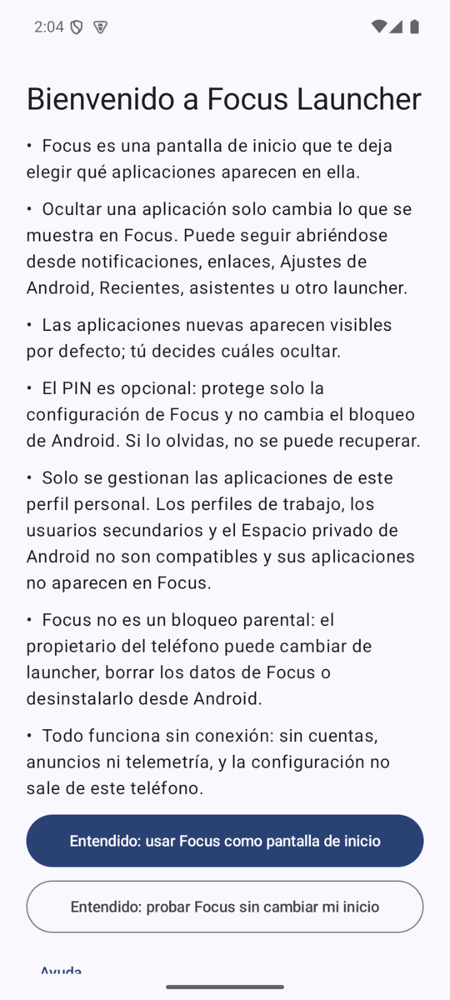

El aviso se puede volver a leer en cualquier momento desde **Ayuda**.

---

## 2. La pantalla de Inicio

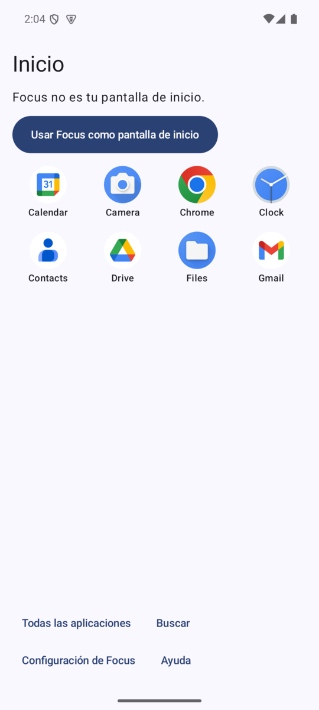

- **Inicio** muestra las **8 primeras apps visibles**, ordenadas por nombre.
- Cuatro accesos fijos abajo: **Todas las aplicaciones**, **Buscar**, **Configuración de Focus** y **Ayuda**.
- El botón azul **«Usar Focus como pantalla de inicio»** solo aparece mientras Focus *no* es tu pantalla de inicio (en estas capturas no lo es). Cuando lo sea, desaparece.

**Todas las aplicaciones** muestra todas las apps **visibles** (no solo 8):

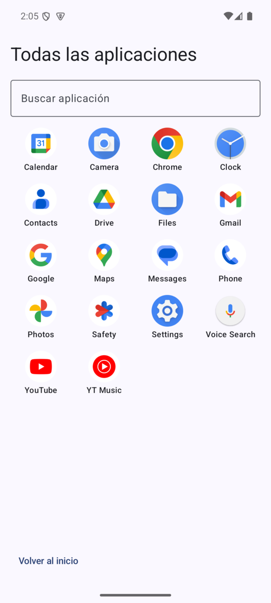

**Buscar** filtra mientras escribes. No distingue mayúsculas ni acentos y **solo encuentra apps visibles** (una app oculta no aparece, ni siquiera escribiendo su nombre exacto):

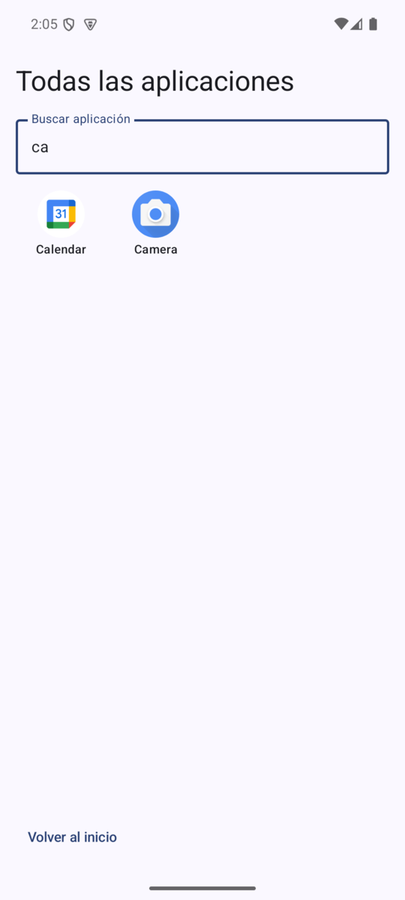

---

## 3. Ocultar y mostrar aplicaciones

1. En **Inicio**, toca **Configuración de Focus**. *(Si ya activaste un PIN, primero te lo pedirá: ver §5.)*
2. Verás **todas las apps que se pueden abrir desde un launcher** (menos Focus) con un interruptor. **Activado = Visible**, **desactivado = Oculta**.

   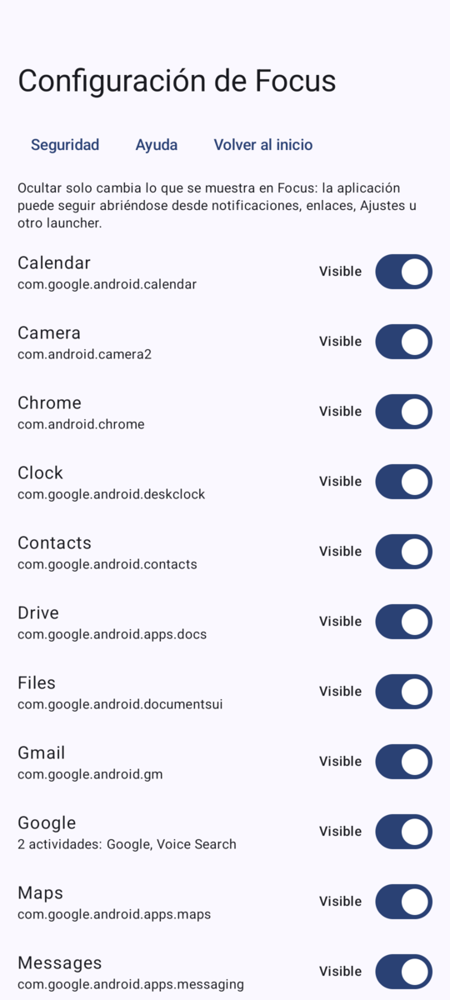

3. **Toca una fila** (el nombre o el interruptor) para alternar su estado. **Cada cambio se guarda al instante**: arriba aparece «Guardando…» y después **«Cambios guardados.»**. No hay botón de guardar.
4. Si algo falla al guardar, el interruptor **no cambia** y se muestra un mensaje de error (nunca se aparenta que se guardó).
5. Vuelve a **Inicio** («Volver al inicio»): la app oculta ya no aparece en Inicio, en **Todas las aplicaciones** ni en la **búsqueda**.

Cosas que conviene saber:

- **Una app con varias pantallas de entrada** (por ejemplo *Google*: «2 actividades: Google, Voice Search») tiene **un solo interruptor** para todas ellas.
- **Las apps nuevas aparecen visibles por defecto.** Si instalas algo después, revisa la configuración (ver §4).
- Si **desinstalas** una app oculta, Focus **recuerda la regla**: verás la fila «No instalada · … · la regla se conserva». Si la reinstalas, vuelve a estar oculta. Puedes quitar esa regla mostrándola.
- Si ocultas **todas**, Inicio muestra «No hay aplicaciones visibles» y **Configuración y Ayuda siguen accesibles** para deshacerlo.

---

## 4. Dejar solo algunas aplicaciones visibles

Es el uso más habitual en un teléfono familiar o de uso limitado: una **lista corta** (por ejemplo Teléfono, Mensajes, Cámara y Chrome).

**Importante:** Focus oculta lo que tú marcas; **no tiene un botón «ocultar todas»**. Para quedarte con pocas, apagas las demás **una por una**. Y como **las apps nuevas nacen visibles**, no es una «lista blanca»: hay que revisarla cuando se instale algo.

### Paso a paso
1. **Configuración de Focus** → recorre la lista (desplázala hasta el final).
2. **Apaga el interruptor de cada app que NO quieres ver.** Deja encendidas solo las que quieres.

   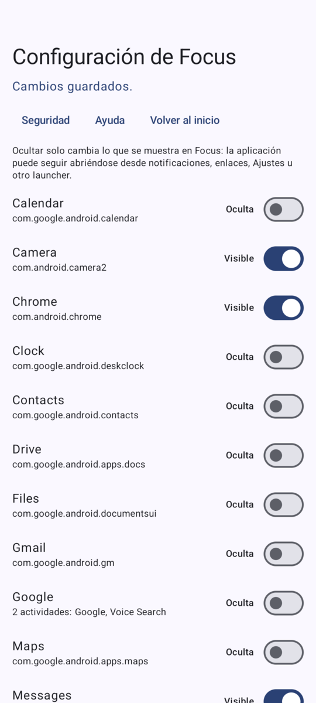

   *En este ejemplo quedan visibles Camera, Chrome, Messages y Phone; las otras 13 están ocultas.*
3. **Volver al inicio.** Ahora Inicio solo muestra esas cuatro:

   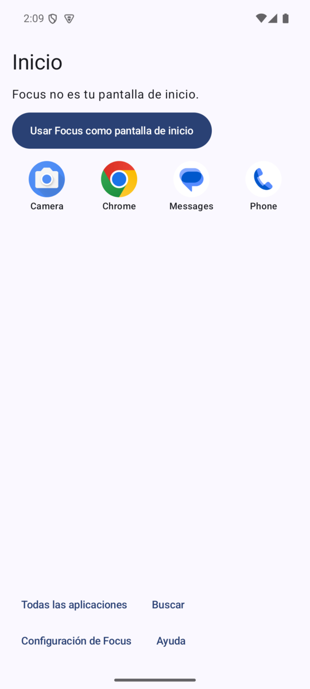

4. **Comprueba:** abre **Todas las aplicaciones** (debe mostrar las mismas cuatro) y prueba **Buscar** con el nombre de una app oculta («Sin resultados»).

### Consejos
- **Hazlo antes de activar el PIN**, o desbloquea con el PIN primero: con PIN activado, cambiar la visibilidad también exige desbloquear.
- Cuando instales una app nueva, **entra en Configuración y ocúltala** si no la quieres a la vista.
- Para añadir una app a la lista corta más adelante, enciende su interruptor.
- Recuerda: ocultar **no** impide abrirla por otras vías (notificaciones, enlaces, Ajustes, otro launcher). Si necesitas impedir su uso, Focus no es la herramienta.

---

## 5. Proteger la configuración con un PIN

El PIN evita que otra persona cambie qué apps se ven. Es **opcional** y empieza desactivado.

### 5.1 Crear el PIN
1. **Configuración de Focus** → **Seguridad**.
2. Escribe un **PIN nuevo de 6 a 12 dígitos** (solo números) y **repítelo** en «Confirmar PIN». El botón **Activar PIN** se habilita cuando ambos coinciden.

   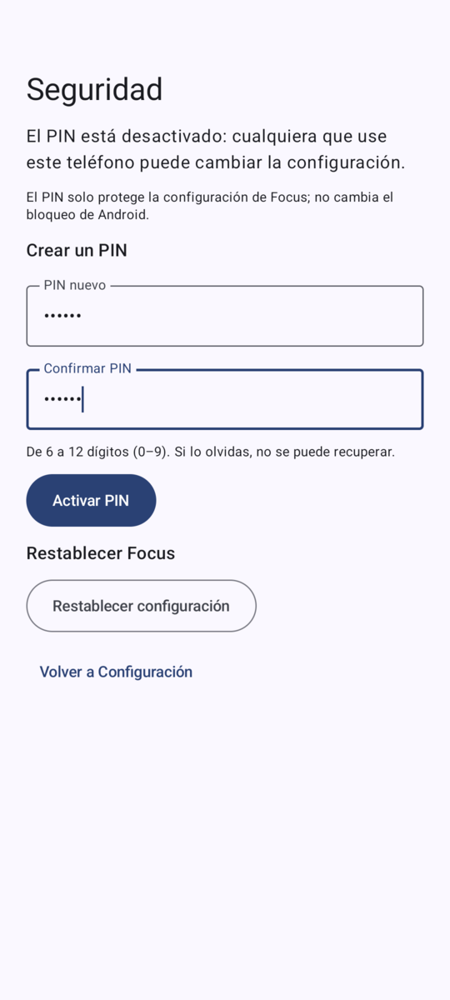

3. Pulsa **Activar PIN**. Puede verse brevemente «Guardando el PIN…» (la protección del PIN es deliberadamente costosa de calcular).
4. Vuelves a **Inicio** con el aviso de confirmación:

   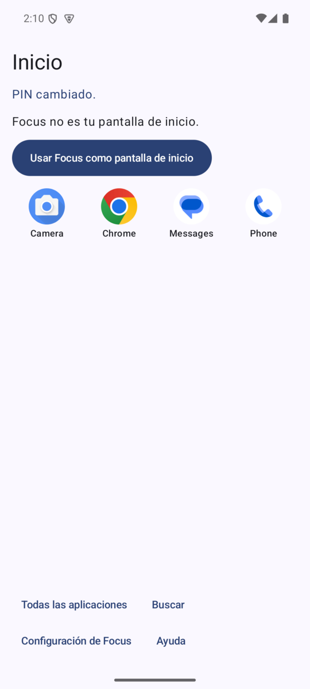

   *(En la captura el aviso es «PIN cambiado.» porque se hizo al cambiar el PIN; al activarlo dice «PIN activado. Se pedirá al abrir la configuración.».)*

> **Guarda el PIN en un lugar seguro.** **Si lo olvidas no hay forma de recuperarlo** (no existe PIN maestro ni pregunta secreta). La única salida es borrar los datos de Focus desde Ajustes de Android (§8), lo que también borra tus reglas.

### 5.2 Qué ocurre después
- Cada vez que toques **Configuración de Focus**, se pide el PIN:

  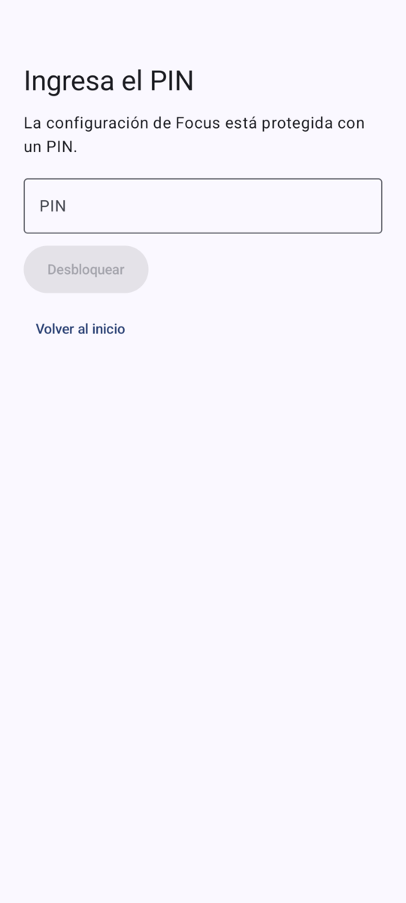

- Si te equivocas, Focus te dice **cuántos intentos quedan**:

  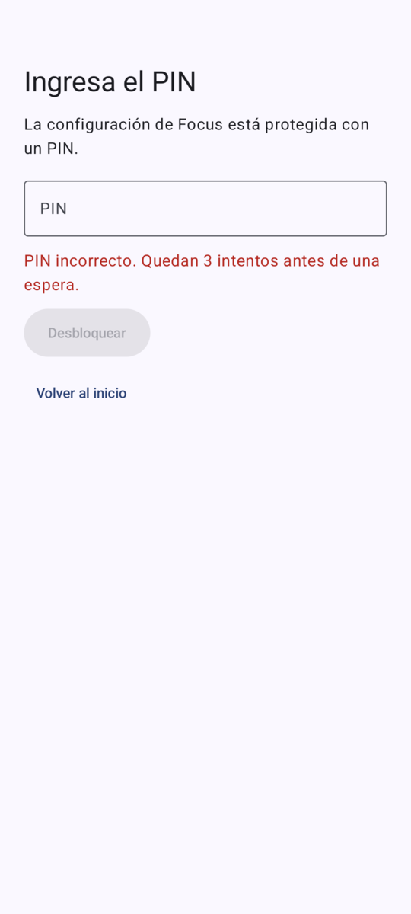

- **Tras 5 intentos fallidos hay una espera** que crece cada vez: 30 s, 1 min, 2 min, 4 min, 8 min y 15 min. Durante la espera no se puede intentar ni con el PIN correcto. **Si Focus se cierra durante la espera, empieza de nuevo por completo** (reiniciar el teléfono tampoco la acorta).

  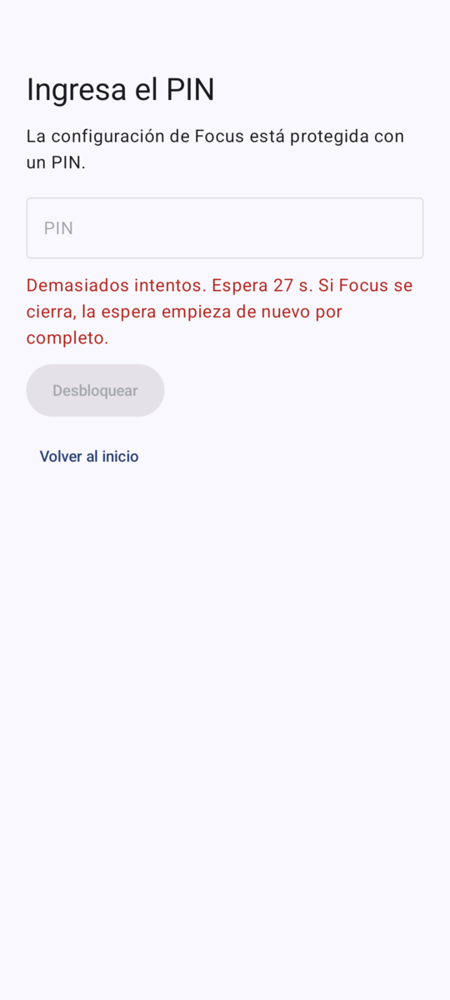

- Con el PIN correcto entras y **la sesión dura como máximo 2 minutos**. Se cierra antes si sales de Configuración, pulsas Inicio, cambias de app o **apagas la pantalla**. Para volver a entrar hay que escribir el PIN otra vez.
- **Lo que el PIN no protege:** abrir apps, buscar ni ver Inicio (eso es libre). Solo protege la configuración.

---

## 6. Cambiar el PIN, quitarlo o restablecer Focus

Con el PIN activado (y la sesión desbloqueada): **Configuración → Seguridad**.

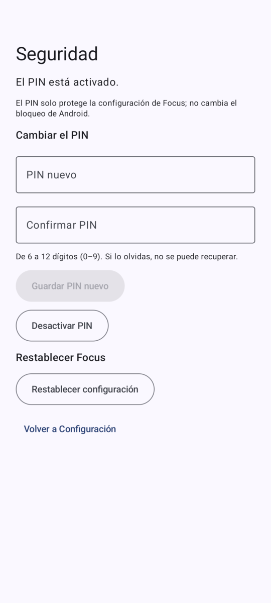

| Acción | Cómo | Resultado |
| --- | --- | --- |
| **Cambiar el PIN** | Escribe el nuevo PIN dos veces → **Guardar PIN nuevo** | Se reemplaza el PIN; deberás usar el nuevo en la próxima entrada |
| **Desactivar el PIN** | **Desactivar PIN** → confirmar en el diálogo | Configuración vuelve a abrirse **sin PIN** (cualquiera podrá cambiarla) |
| **Restablecer configuración** | **Restablecer configuración** → confirmar en el diálogo | Borra **todas las reglas, el aviso inicial y el PIN**; Focus vuelve a empezar desde el aviso de alcance. **No se puede deshacer** |

Desactivar el PIN y restablecer piden una **confirmación explícita** antes de actuar.

---

## 7. Configuración recomendada de principio a fin

1. Instala Focus y elígelo como pantalla de inicio (README §3–§4).
2. **Oculta** lo que no quieras a la vista, **dejando solo las apps necesarias** (§3–§4).
3. **Activa un PIN** de 6–12 dígitos (§5) y **anótalo** en un lugar seguro.
4. **Comprueba:** vuelve a Inicio y abre Configuración (debe pedir el PIN); prueba una app oculta en **Buscar** («Sin resultados»).
5. Cuando se instale una app nueva: Configuración (con el PIN) → ocúltala si no quieres que aparezca.

---

## 8. Si algo no sale como esperabas

| Situación | Qué hacer |
| --- | --- |
| **Olvidé el PIN** | No se puede recuperar. **Ayuda → «Abrir ajustes de pantalla de inicio»** y elige otro launcher; después **Ayuda → «Abrir información de la app de Focus» → Almacenamiento → Borrar datos**. Se pierden reglas y PIN; vuelves a configurar desde cero. Detalle en el [README §6](README.md) |
| Una app oculta **sigue abriéndose** (notificación, enlace, Ajustes) | Es lo esperado: Focus solo controla lo que *él* muestra |
| **No aparece una app** que acabo de instalar | Revisa que no tenga una regla de «Oculta» (reinstalar una app oculta antes la deja oculta) y vuelve a abrir Inicio |
| Inicio dice **«No se pudo leer la configuración»** | Es un error temporal: pulsa **Reintentar**. Por seguridad no se muestra ninguna app hasta poder leerla |
| Inicio dice **«La configuración necesita recuperación»** | El archivo de configuración está dañado o no es válido. Focus no la arregla solo: **Ayuda** explica la causa y los pasos (cambiar de launcher y borrar datos) |
| Quiero **volver a mi launcher anterior** | **Ayuda → «Abrir ajustes de pantalla de inicio»** y elígelo |

**Ayuda** está siempre disponible, **con o sin PIN**, y repite estos límites:

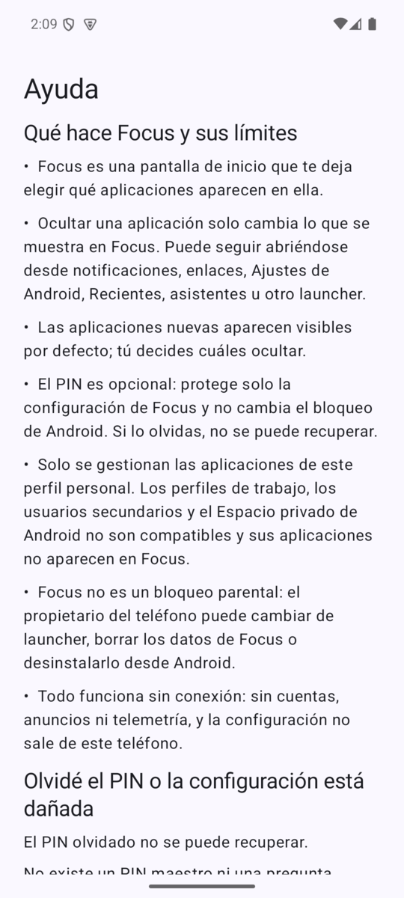

---

## 9. Chuleta

| Quiero… | Dónde | Notas |
| --- | --- | --- |
| Ocultar / mostrar una app | Inicio → Configuración de Focus → interruptor | Se guarda al instante |
| Dejar solo algunas | Apagar todas menos las elegidas | Una por una; las nuevas nacen visibles |
| Poner PIN | Configuración → Seguridad → Activar PIN | 6–12 dígitos; **no recuperable** |
| Cambiar / quitar PIN | Configuración → Seguridad | Pide el PIN y confirmación |
| Abrir una app | Inicio (8 primeras) o Todas las aplicaciones | — |
| Buscar | Inicio → Buscar | Solo apps visibles |
| Restablecer todo | Configuración → Seguridad → Restablecer | Borra reglas, aviso y PIN |
| Recuperar sin PIN | Ayuda → cambiar launcher → Borrar datos | Se pierde la configuración |

---

## Sobre las capturas de este documento

- **Capturas reales** de un emulador Pixel 6 con Android 15 y Focus en funcionamiento: aviso inicial, Inicio, Todas las aplicaciones, búsqueda, Inicio con lista corta, el aviso de confirmación del PIN y Ayuda.
- **Imágenes renderizadas por la propia interfaz** (mismos componentes y mismo tema): el editor de visibilidad, Seguridad y la pantalla del PIN. **Las pantallas de Configuración, Seguridad y PIN bloquean las capturas del sistema a propósito** (para que tampoco salgan en Recientes ni en grabaciones), así que no se pueden capturar como las demás. Los datos que muestran son de ejemplo (con los nombres de paquete reales de las apps del emulador).
- Pueden diferir ligeramente del teléfono real (colores del tema dinámico, tamaño de pantalla y fuente, e idioma del sistema para los diálogos de Android).
- Para regenerar las imágenes renderizadas: `./gradlew :app:assembleDebug :app:assembleDebugAndroidTest`, instalar ambos APK en un emulador y ejecutar `adb shell am instrument -w -e class com.focuslauncher.docs.DocScreenshotsTest -e docScreenshots true com.focuslauncher.test/com.focuslauncher.HiltTestRunner`; los PNG quedan en `files/docs/` del paquete (`adb exec-out run-as com.focuslauncher cat files/docs/<nombre>.png`).
